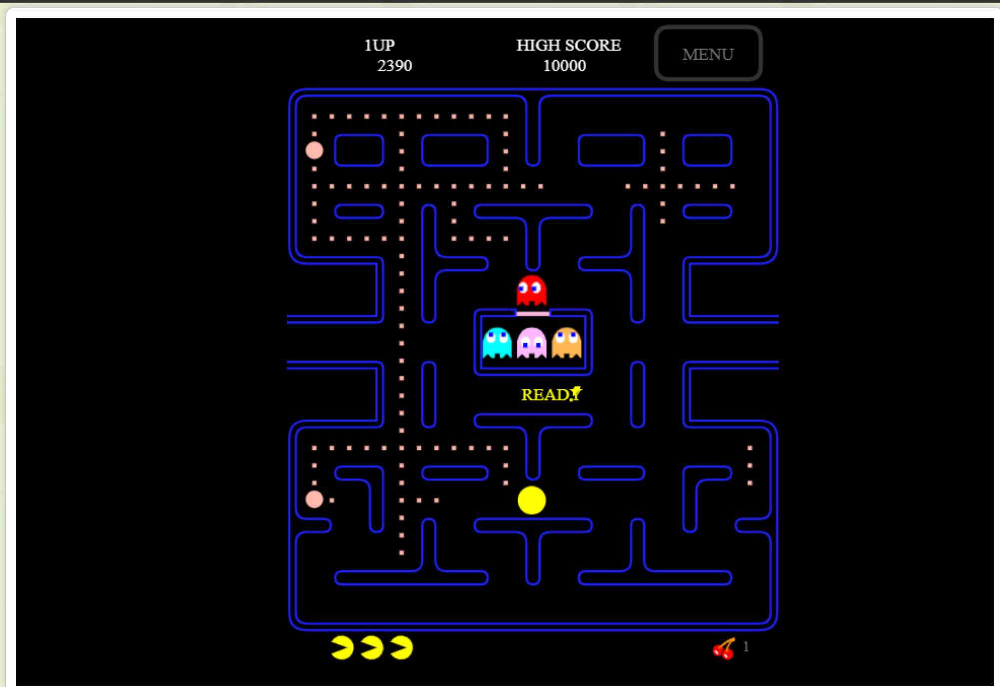

# Pacdown

Pac-Man és un cercle groc amb boca que s'introdueix en laberints per a menjar punts i premis.

##  Autor/a de la informació: Oriol Lacasa

[Repositori base](https://github.com/OriolLacasa)

## Web per jugar
[Enllaç](https://pacmangratis.net/)

## Foto amb el joc

## Blinky
[Enllaç a la descrpció](blinky.md)

## Pinky
[Enllaç a la descrpció](pinky.md)

## Inky
[Enllaç a la descrpció](inky.md)

## Clyde
[Enllaç a la descripció](clyde.md)

